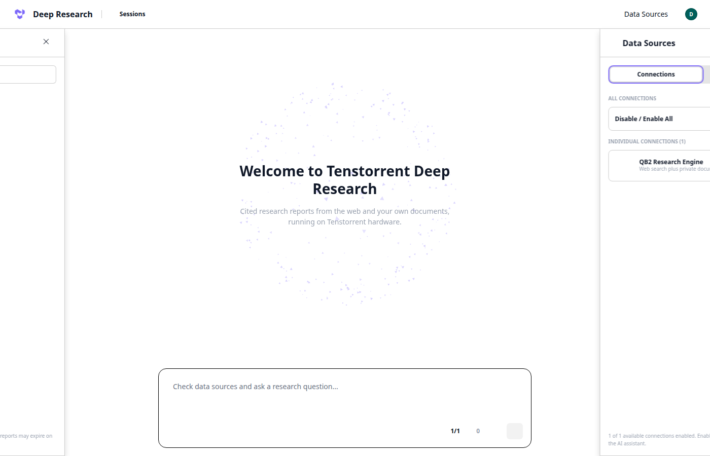

# Setup

## One command

```bash
uv sync && uv run ttdr up
```

`ttdr up` does everything below in order: pre-fetches adapters the bundles don't ship (`prefetch` in the recipe), stages chat templates, serves each model that isn't already up (largest first, so tt assigns chips 0–1, 2, 3), clones and patches AI-Q if needed (`scripts/setup-aiq.sh`), runs `docker compose --profile app up -d` and waits for every endpoint. App containers (`engine`, `aiq`, `ui`, `ocr`) use host networking, so the recipe's localhost URLs reach the models unchanged. Add `--build` after changing code. The sections below are the same steps by hand.

## Prerequisites

- QB2 (4× p300c, detected as `p300x2`), Docker with Compose, uv
- tt ≥ 1.2.1 (`tt self update --yes`)

## Serve the models

tt assigns chips itself, so start the models one at a time, largest first. All three are unverified community bundles, which is why each command needs `--yes`.

| Port | Model | Bundle | Chips | Ready in (first pull) |
|---|---|---|---|---|
| 8000 | Ornith 1.5 35B-A3B | `raahemnabeel/ornith-1.5-35b-a3b`, profile `p300`, patched chat template | 2 | 9m 41s (4m 30s cached) |
| 8001 | embeddinggemma-2 | `tt-hous/embeddinggemma-2` | 1 | 5m 56s |
| 8002 | Laya | `tt-hous/laya` | 1 | 2m 30s |

```bash
mkdir -p /opt/tenstorrent/models/ttdr && cp configs/chat_templates/ornith.jinja /opt/tenstorrent/models/ttdr/
tt serve raahemnabeel/ornith-1.5-35b-a3b --yes --port 8000 -- --profile p300 --chat-template /hf/ttdr/ornith.jinja
tt serve tt-hous/embeddinggemma-2 --yes --port 8001
tt serve tt-hous/laya --yes --port 8002
```

**Ornith chat template.** Ornith's stock template raises "No user query found" when a request has no user turn. AI-Q's intent classifier sends system-only prompts. `configs/chat_templates/ornith.jinja` is the stock template with that one `raise` replaced by a fallback (a one-line diff). It's mounted through `/opt/tenstorrent/models`, which the container sees as `/hf`.

The alternative LLM is gpt-oss-20b: `tt serve jashansinghTT/gpt-oss-20b-blackhole-fast --yes --port 8000 -- --profile p150x2`, with `--recipe recipes/gpt-oss.toml` on `ttdr` commands. Its sampling must keep `top_k <= 32` (see the recipe).

**Laya workaround.** The bundle's pull leaves out the repo's `multilingual/` folder, but the server checks for the full snapshot and runs offline, so it exits with code 3. Fetch the full snapshot once, before the first serve:

```bash
hf download convaiinnovations/laya --revision 7b928d828b7b0e022f929d9bd2e44165aa270148 \
  --cache-dir /opt/tenstorrent/models/hub
```

To stop a model, run `tt model stop <bundle>`. To see its logs, run `tt model logs <bundle> --follow`.

**Swapping a model:** stop it, reset the chips it held, then serve the new one. Without the reset, the next model can fail to bring its ethernet cores up.

```bash
tt model stop <bundle>
tt device reset <chips> --yes      # only the freed chips; the other models keep running
tt serve <new-bundle> --yes --port 8000 -- --profile <profile>
```

## Start the data services and check everything

```bash
docker compose up -d     # Qdrant :6333, SearXNG :8888, Redis :6379 (localhost only)
uv run ttdr health       # exits 0 only if every endpoint is up
uv run ttdr mcp          # engine MCP server at :9901/mcp (tools: search, fetch_page, get_evidence)
```

Clients call the model endpoints listed in `recipe.toml` directly.

Warm `ttdr health` latencies: llm 1.8 s, embed 17 ms, decide 15 ms, qdrant 4 ms, searxng 0.5 s, redis 3 ms.

## Documents

```bash
uv run ttdr corpus fetch financebench    # 84 pinned 10-K PDFs → data/corpus/financebench (159 MB)
uv run ttdr corpus index financebench    # text layer + page flags → chunks → embeddings → Qdrant (~3 min)
uv run ttdr corpus search "3M capital expenditure 2018" --corpus financebench
uv run ttdr corpus recall                # gold evidence page in top k, FinanceBench
```

Pages are 0-indexed, matching FinanceBench. Each page gets flags: `text_ok`, `image_only`, `bad_text` or `large_figure`. They're written to `data/corpus/<name>/pages.jsonl` for the OCR stage. Image-only pages aren't embedded yet. Chunks are 1,500 characters with a 200-character overlap. Each has an evidence ID such as `3M_2018_10K#p59.0` (doc, page, chunk).

**Search engines.** SearXNG scrapes public engines, and they rate-limit. After a few thousand searches, Brave, DuckDuckGo and Google suspended us ("too many requests", CAPTCHA). `configs/searxng/settings.yml` enables Bing, Yahoo, Mojeek and Startpage as well, to spread the load. Search results are cached in Redis for 24 hours.

## Smoke tests (raw curl)

```bash
# LLM
curl -s localhost:8000/v1/chat/completions -H 'content-type: application/json' \
  -d '{"model":"openai/gpt-oss-20b","messages":[{"role":"user","content":"What is a 10-K?"}],"max_tokens":200}'

# Embeddings (768-dim; Matryoshka 512/256/128 also available)
curl -s localhost:8001/v1/embeddings -H 'content-type: application/json' \
  -d '{"model":"google/embeddinggemma-2","input":["query","passage"]}'

# Decision model: a state plus named questions. Types are noul (0..1), choice (criteria) or score.
curl -s localhost:8002/v1/systemone -H 'content-type: application/json' -d '{
  "state": "Passage: ...\nClaim: ...",
  "questions": {
    "support":  {"type": "choice", "instructions": "Does the passage support the claim?",
                 "criteria": {"supported": "...", "contradicted": "...", "not_enough_info": "..."}},
    "relevant": {"type": "noul", "instructions": "Is the passage relevant to the claim?"}
  }}'
```

Laya also has `/v1/systemone/batch` (many states, shared forward passes) and `/v1/forward` (raw tensors). Each state is capped at 512 tokens, so passages must be chunked to fit. Every question shares a 256-token head budget.

## Measured at bring-up (single request, warm)

| Endpoint | Latency |
|---|---|
| LLM, "Say OK.", 32 max tokens | 1.7 s |
| LLM, one-sentence answer (88 tokens, 39 of them reasoning) | 5.1 s |
| Embeddings, 3 short inputs | 19 ms |
| Laya, 2 questions, ~160 tokens | 10 ms |

## Alternatives

- Don't use `tt-hous/laya-typed-decisions`. It's a specialist for invoices, security, customer service and agent traces, and it got 2 of 3 claim-support checks right (base Laya got 3 of 3).
- The decision model can be `tt-hous/kev-9b` (Qwen3.5-9B base, one chip, port 8008) instead of Laya. Which one we keep is decided at Stage 6.
- gpt-oss-20b also has a `p150x2-throughput` profile, with 32K prefill steps instead of 8K and base-package decode. Decode measured with `ignore_eos`, 256 tokens per request:

  | Profile | 1 stream | 8 | 16 | 32 (aggregate) |
  |---|---|---|---|---|
  | `p150x2` (used) | 34 tok/s | 102 | 130 | 162 tok/s |
  | `p150x2-throughput` | 20 tok/s | 102 | 128 | 162 tok/s |

  The prefill side gets A/B'd at Stage 9.

## AI-Q (research harness)

AI-Q is NVIDIA's deep-researcher blueprint (`NVIDIA-AI-Blueprints/deep-researcher-agent`, Apache-2.0). We configure it rather than fork it: the clone is gitignored, and our config lives in `configs/aiq/`.

```bash
git clone --depth 1 --branch v2.2.1 https://github.com/NVIDIA-AI-Blueprints/deep-researcher-agent external/aiq
(cd external/aiq && git apply ../../patches/aiq/*.patch && uv sync && uv pip install -e ./frontends/cli)
(cd external/aiq/frontends/ui && npm ci)                # Node 22+

uv run ttdr mcp &                                        # engine tools at :9901/mcp, AI-Q's only data source
uv run ttdr aiq-config                                    # recipe + configs/aiq/ttdr.yml → data/aiq/config/ttdr.yml
external/aiq/.venv/bin/nat serve --config_file data/aiq/config/ttdr.yml   # job API at :8100
(cd external/aiq/frontends/ui && npm run build && BACKEND_URL=http://127.0.0.1:8100 PORT=3000 npm start)   # UI at :3000
```

`configs/aiq/ttdr.yml` is a template: AI-Q's structure and each role's intent (thinking on or off, token limits). `ttdr aiq-config` (run by `ttdr up`) fills in the recipe's llm (name, URL, sampling, reasoning control) and MCP URL. It uses our MCP server as the only data source. The clarifier is off, so runs complete unattended. `nat serve` needs no other services: jobs go to SQLite (`data/aiq/jobs.db`), deep research runs on a local Dask cluster, and auth is off (`REQUIRE_AUTH` unset). No NVIDIA API key is needed, because every LLM is `_type: openai`.

Job API, for scripts and evals (`ttdr eval run aiq -p agent=deep_researcher`):

```bash
curl -X POST 127.0.0.1:8100/v1/jobs/async/submit -H 'content-type: application/json' \
  -d '{"agent_type": "deep_researcher", "input": "your question", "data_sources": ["ttdr"]}'
curl 127.0.0.1:8100/v1/jobs/async/job/<id>          # submitted | running | success | failure
curl -N 127.0.0.1:8100/v1/jobs/async/job/<id>/stream  # server-sent events: tool calls, LLM output
curl 127.0.0.1:8100/v1/jobs/async/job/<id>/report
```

`nat run --config_file data/aiq/config/ttdr.yml --input "..."` still runs one question from the command line.

The UI runs as a production build: `npm run dev` (Turbopack) hits the OS file-watch limit on this host.



**Patches** (`patches/aiq/`, applied to the pinned clone):

- `0001-raise-research-budgets`: AI-Q caps every research budget at its default (100 source-tool calls and 20 research queries per job), sized for paid search APIs. This raises the caps to 1,000 and 60, and the 1-hour wall-clock limit per deep job to 3 hours. Our search is local, so the extra calls cost nothing.
- `0002-agent-loop-guards`: caps `think` at 8 calls and source calls at 40 per agent run; past 40 the search tools are removed, so the agent can only return its result. Without these, Ornith can repeat the same call indefinitely.
- `0004-auto-tool-choice`: opt-in (`AIQ_AUTO_TOOL_CHOICE=1`, set from the recipe's `features.auto_tool_choice`): the model chooses its tools instead of LangChain forcing the structured-output tool every turn. Forced choices are served with guided decoding, which slows every request in the batch about 9× on this bundle; AI-Q's text fallbacks recover the structured result when the model answers in JSON text.
- `0005-truncation-guard`: after a reply is cut off at `max_tokens`, that agent run continues with thinking off; after three, it is told to return its result now; every agent run is capped at 40 model calls. Without it, a researcher that thinks to the limit never returns a result, and LangChain's structured-output retry asks again until the job times out.
- `0003-tenstorrent-branding`: the web UI as "Tenstorrent Deep Research": the Tenstorrent mark (from `tenstorrent/tt-metal` docs, see `configs/branding/SOURCE`) instead of NVIDIA's, page title, and the brand colour moved from NVIDIA green to Tenstorrent purple (#7c68fa).

The MCP server answers a repeated search from cache, with a note telling the model it already ran that search.
