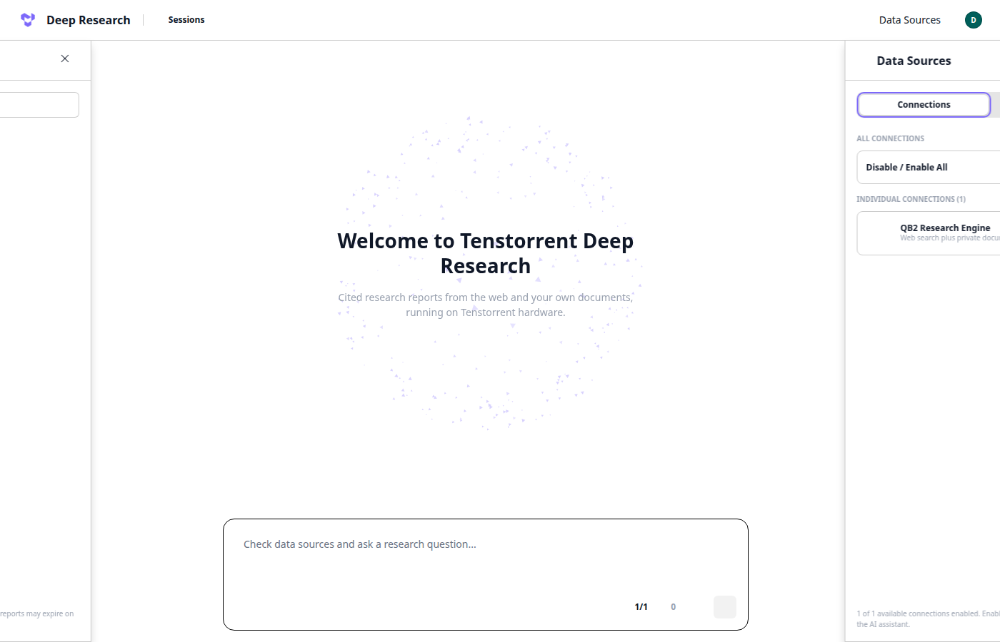

# Setup

## One command

```bash
uv sync && uv run ttdr up
```

`ttdr up` does everything below in order: pre-fetches adapters the bundles don't ship (`prefetch` in the recipe), stages chat templates, serves each model that isn't already up (largest first, so tt assigns chips 0–1, 2, 3), clones and patches AI-Q if needed (`scripts/setup-aiq.sh`), runs `docker compose --profile app up -d` and waits for every endpoint. App containers (`engine`, `aiq`, `ui`, `ocr`) use host networking, so the recipe's localhost URLs reach the models unchanged. Add `--build` after changing code. The sections below are the same steps by hand.

## Prerequisites

- QB2 (4× p300c, detected as `p300x2`), Docker with Compose, uv
- tt ≥ 1.2.1 (`tt self update --yes`)

## Serve the models

tt assigns chips itself, so start the models one at a time, largest first. All three are community bundles, which is why each command needs `--yes`.

| Port | Model | Bundle | Chips |
|---|---|---|---|
| 8000 | Ornith 1.5 35B-A3B | `raahemnabeel/ornith-1.5-35b-a3b`, profile `p300`, patched chat template | 2 (0–1) |
| 8005 | Qwen3-VL-Embedding-8B | `raahemnabeel/qwen3-vl-embedding-8b` | 1 (2) |
| 8004 | Qwen3-VL-Reranker-8B | `raahemnabeel/qwen3-vl-reranker-8b` | 1 (3) |

```bash
mkdir -p /opt/tenstorrent/models/ttdr && cp configs/chat_templates/ornith.jinja /opt/tenstorrent/models/ttdr/
tt serve raahemnabeel/ornith-1.5-35b-a3b --yes --port 8000 -- --profile p300 --chat-template /hf/ttdr/ornith.jinja --max-num-batched-tokens 262144
tt serve raahemnabeel/qwen3-vl-embedding-8b --yes --port 8005
tt serve raahemnabeel/qwen3-vl-reranker-8b --yes --port 8004
```

Ornith takes about 10 minutes from a first pull (4–5 cached). The claim checker (`verify`) is Ornith itself; recipes such as `recipes/kev.toml` put a separate decision model on chip 3 instead of the reranker (Laya, below, is the one the earlier A/Bs used).

**Ornith chat template.** Ornith's stock template raises "No user query found" when a request has no user turn. AI-Q's intent classifier sends system-only prompts. `configs/chat_templates/ornith.jinja` is the stock template with that one `raise` replaced by a fallback (a one-line diff). It's mounted through `/opt/tenstorrent/models`, which the container sees as `/hf`.

The alternative LLM is gpt-oss-20b: `tt serve jashansinghTT/gpt-oss-20b-blackhole-fast --yes --port 8000 -- --profile p150x2`, with `--recipe recipes/gpt-oss.toml` on `ttdr` commands. Its sampling must keep `top_k <= 32` (see the recipe).

**Laya workaround.** The bundle's pull leaves out the repo's `multilingual/` folder, but the server checks for the full snapshot and runs offline, so it exits with code 3. Fetch the full snapshot once, before the first serve:

```bash
hf download convaiinnovations/laya --revision 7b928d828b7b0e022f929d9bd2e44165aa270148 \
  --cache-dir /opt/tenstorrent/models/hub
```

To stop a model, run `tt model stop <bundle>`. To see its logs, run `tt model logs <bundle> --follow`.

**Swapping a model:** stop it, reset the chips it held, then serve the new one. Without the reset, the next model can fail to bring its ethernet cores up.

```bash
tt model stop <bundle>
tt device reset <chips> --yes      # only the freed chips; the other models keep running
tt serve <new-bundle> --yes --port 8000 -- --profile <profile>
```

## Start the data services and check everything

```bash
docker compose up -d     # Qdrant :6333, SearXNG :8888, Redis :6379 (localhost only)
uv run ttdr health       # exits 0 only if every endpoint is up
uv run ttdr mcp          # engine MCP server at :9901/mcp (tools: search, fetch_page, get_evidence)
```

Clients call the model endpoints listed in `recipe.toml` directly.

Warm `ttdr health` latencies: llm 1.8 s, embed 17 ms, decide 15 ms, qdrant 4 ms, searxng 0.5 s, redis 3 ms.

## Documents

```bash
uv run ttdr corpus fetch financebench    # 84 pinned 10-K PDFs → data/corpus/financebench (159 MB)
uv run ttdr corpus index financebench    # text layer + page flags → chunks → embeddings → Qdrant (~3 min)
uv run ttdr corpus search "3M capital expenditure 2018" --corpus financebench
uv run ttdr corpus recall                # gold evidence page in top k, FinanceBench
```

Pages are 0-indexed, matching FinanceBench. Each page gets flags: `text_ok`, `image_only`, `bad_text` or `large_figure`. They're written to `data/corpus/<name>/pages.jsonl` for the OCR stage. Image-only pages aren't embedded yet. Chunks are 1,500 characters with a 200-character overlap. Each has an evidence ID such as `3M_2018_10K#p59.0` (doc, page, chunk).

**Search engines.** SearXNG scrapes public engines, and they rate-limit. After a few thousand searches, Brave, DuckDuckGo and Google suspended us ("too many requests", CAPTCHA). `configs/searxng/settings.yml` enables Bing, Yahoo, Mojeek and Startpage as well, to spread the load. Search results are cached in Redis for 24 hours.

## Google Drive import

For Tenstorrent, once per product: customers never create a Google Cloud project or edit a file. One Tenstorrent project's three browser-side values ship in `recipe.toml`, every install signs its users in through that project, and each person's Google token reaches only the files they pick (docs/CONNECTORS.md). Until the values are filled in, the backend reports Google Drive as not set up and the UI shows no button. SharePoint and OneDrive work the same way ([below](#sharepoint-and-onedrive-import)).

Sign-in works only when the UI is opened at `http://localhost:3000` or `http://127.0.0.1:3000` (the recipe's `[connectors] origins`, shared by both stores): a Web application OAuth client accepts only registered JavaScript origins, and Google and Microsoft allow plain `http` only for localhost. Customers on another machine use an SSH port forward (`ssh -L 3000:localhost:3000 <user>@<host>`), and the UI says so when it is opened at any other address. The AI-Q UI on :3001 is not registered.

1. **Project.** In the [Google Cloud console](https://console.cloud.google.com/), create a project owned by a Tenstorrent organization account (for example `tt-deep-research`), with at least two owners so it outlives any one person.
2. **APIs.** APIs & Services → Library: enable the **Google Drive API** and the **Google Picker API**.
3. **Consent screen** (Google Auth Platform):
   - Branding: app name (Tenstorrent Deep Research), support email, logo, home page, privacy policy, and `tenstorrent.com` as an authorized domain. These are what people see when they sign in.
   - Audience: **External**, so any Google account, personal or Workspace, can sign in. Publish the app (In production). While it is in Testing, only listed test users can sign in.
   - Data access: add only `https://www.googleapis.com/auth/drive.file` (access to files the person picks). It is a non-sensitive scope, so there is no security assessment. Brand verification (Google checks the name, logo and domain) is needed before more than 100 users can sign in, so finish it before shipping.
4. **OAuth client.** Clients → Create client → **Web application**. Authorized JavaScript origins: `http://localhost:3000` and `http://127.0.0.1:3000`. No redirect URIs. Copy the client ID (`….apps.googleusercontent.com`). There is no client secret to keep: the token client doesn't use one.
5. **API key.** APIs & Services → Credentials → Create credentials → API key. Restrict it to the **Google Picker API** (API restrictions), and to **Websites** `http://localhost:3000/*` and `http://127.0.0.1:3000/*` (application restrictions). It ships to every browser, so these restrictions are what keep it from being used elsewhere.
6. **Project number.** The project dashboard (or IAM & Admin → Settings) shows the **project number**: digits only, not the project ID. It is the Picker's `app_id`, which ties picked files to this project's OAuth client.
7. **Ship the values** in `recipe.toml`, which every recipe extends:

   ```toml
   [connectors]
   origins = ["http://localhost:3000", "http://127.0.0.1:3000"]   # step 4's JavaScript origins

   [connectors.google_drive]
   client_id = "1234567890-abc123.apps.googleusercontent.com"
   api_key = "AIza..."
   app_id = "1234567890"
   ```

   All three are public by design (the browser needs them to show Google's sign-in and picker). Keep `origins` the same as step 4's list; the UI disables the button on any other origin.
8. **Check.** `uv run ttdr up`, then `curl -s localhost:8200/v1/connectors` shows `google-drive` with `"configured": true`, and http://localhost:3000 shows **Import from Google Drive** in the Files tab of the data-sources panel. Import a Google Doc and a PDF from a personal and a Workspace test account.

A value in the wrong form (a client ID that isn't an OAuth client ID, a project ID instead of the number) leaves Google Drive off and logs `Google Drive import is off: [connectors.google_drive] …` in the `deepagents` container; the rest of the app runs.

**Development override.** To test with your own project without editing the recipe, set `TTDR_GOOGLE_CLIENT_ID`, `TTDR_GOOGLE_API_KEY` and `TTDR_GOOGLE_APP_ID` in your shell or `.env` (compose passes them to `deepagents`). Each one set replaces the recipe's value; the origins still come from the recipe.

## SharePoint and OneDrive import

For Tenstorrent, once per product, like Google Drive: one Microsoft Entra app registration's client ID ships in `recipe.toml`. The recipe's `accounts` says who signs in:

- `"work"` (the default): **work and school accounts** (Entra ID). People pick from their OneDrive and from the document libraries of the SharePoint sites they can open, with the delegated, read-only `Files.Read.All` and `Sites.Read.All`. Graph limits both to what the person can already open.
- `"personal"`: **personal Microsoft accounts** (outlook.com, hotmail.com, live.com), their own OneDrive only, with `Files.Read`.
- `"any"`: either. The import first asks **Work or school account** (SharePoint and OneDrive) or **Personal Microsoft account** (OneDrive), then signs in with that kind's authority and scopes. The server tells the tokens apart: a work token is a JWT from an Entra tenant, and gets the work checks.

The registration's supported account types must match. The browser uses MSAL with the authorization code flow and PKCE in a popup: there is no client secret. Sign-in has the same localhost requirement as Google.

1. **Register the app.** In the [Microsoft Entra admin center](https://entra.microsoft.com/) of Tenstorrent's tenant: Applications → App registrations → New registration.
   - Name: Tenstorrent Deep Research (people see it when they sign in).
   - Supported account types: for `"work"`, **Accounts in any organizational directory (Multitenant)**, or **this organizational directory only** for an app registered in the customer's own tenant (then set `tenant`); for `"personal"`, **Personal Microsoft accounts only**; for `"any"`, **Accounts in any organizational directory and personal Microsoft accounts**. Switching an existing app to that last type can fail with "requestedAccessTokenVersion is invalid": in Manifest set `"requestedAccessTokenVersion": 2` (under `api`; `accessTokenAcceptedVersion` in the older manifest), save, then change the type.
   - Redirect URI: platform **Single-page application (SPA)**, `http://localhost:3000/auth/msal-redirect`.
2. **Redirect URIs.** Authentication → Single-page application: add `http://127.0.0.1:3000/auth/msal-redirect` too, so both registered origins work. Leave implicit grant (access and ID tokens) off, and "Allow public client flows" off; the SPA platform gives the auth code flow with PKCE.
3. **Permissions.** API permissions: remove the default `User.Read`, and add Microsoft Graph → **Delegated**:
   - `"work"`: **`Files.Read.All`** and **`Sites.Read.All`**. Neither needs admin consent by default, so people consent for themselves on first sign-in. A tenant that limits user consent (to verified publishers, or to admins) needs its admin to grant consent once (Grant admin consent, or the admin consent URL), or a verified publisher (step 5).
   - `"personal"`: **`Files.Read`** (the person's own files).
   - `"any"`: all three. Personal accounts are only asked for `Files.Read`. Shared with me would need `Files.Read.All` and Graph's deprecated `sharedWithMe`, so such items show as not supported yet.

   MSAL adds the standard sign-in scopes (`openid`, `profile`, `offline_access`).
4. **No secret.** Leave Certificates & secrets empty: the browser is a public client and the server holds no Microsoft credentials.
5. **Branding.** Branding & properties: logo, home page, terms of service and privacy statement URLs, and the publisher domain (`tenstorrent.com`, verified in Entra). For customers' tenants that allow consent only to verified publishers, add publisher verification (a Microsoft AI Cloud Partner Program ID).
6. **Ship the values** in `recipe.toml`: Overview → Application (client) ID, a GUID.

   ```toml
   [connectors.onedrive]
   client_id = "0f9c2b4e-1a2b-4c3d-8e9f-0123456789ab"
   accounts = "work"     # or "personal", or "any" for either
   tenant = ""           # work or any: a Directory (tenant) ID to accept work accounts from one organization only
   ```

   The redirect URIs are the `[connectors] origins` plus `/auth/msal-redirect`; keep the two lists in step. With `tenant` set, work sign-in goes to that tenant and the server refuses work tokens from any other (personal accounts, with `"any"`, are unaffected).
7. **Check.** `uv run ttdr up`, then `/v1/connectors` shows `onedrive` with `"configured": true`, and the Files tab shows **Import from SharePoint and OneDrive** (**Import from OneDrive** for personal accounts). Sign in with a work account, open a SharePoint site and its library, and import a picked PDF, a PowerPoint (as PDF) and a folder; then the same from My files. Try it from both `http://localhost:3000` and `http://127.0.0.1:3000`. With `"any"`, import once as each kind.

A client ID or tenant that isn't a GUID leaves the import off and logs `OneDrive import is off: [connectors.onedrive] …`. `TTDR_MICROSOFT_CLIENT_ID` overrides the recipe's client ID for development.

**Preview (development only).** `TTDR_CONNECTORS_PREVIEW=1` in `.env` shows stores that have no values yet as disabled buttons ("Not set up on this installation yet"), to see the Files tab before the registrations exist. Off by default; never ship it on.

## Smoke tests (raw curl)

```bash
# LLM
curl -s localhost:8000/v1/chat/completions -H 'content-type: application/json' \
  -d '{"model":"openai/gpt-oss-20b","messages":[{"role":"user","content":"What is a 10-K?"}],"max_tokens":200}'

# Embeddings (768-dim; Matryoshka 512/256/128 also available)
curl -s localhost:8001/v1/embeddings -H 'content-type: application/json' \
  -d '{"model":"google/embeddinggemma-2","input":["query","passage"]}'

# Decision model: a state plus named questions. Types are noul (0..1), choice (criteria) or score.
curl -s localhost:8002/v1/systemone -H 'content-type: application/json' -d '{
  "state": "Passage: ...\nClaim: ...",
  "questions": {
    "support":  {"type": "choice", "instructions": "Does the passage support the claim?",
                 "criteria": {"supported": "...", "contradicted": "...", "not_enough_info": "..."}},
    "relevant": {"type": "noul", "instructions": "Is the passage relevant to the claim?"}
  }}'
```

Laya also has `/v1/systemone/batch` (many states, shared forward passes) and `/v1/forward` (raw tensors). Each state is capped at 512 tokens, so passages must be chunked to fit. Every question shares a 256-token head budget.

## Measured at bring-up (single request, warm)

| Endpoint | Latency |
|---|---|
| LLM, "Say OK.", 32 max tokens | 1.7 s |
| LLM, one-sentence answer (88 tokens, 39 of them reasoning) | 5.1 s |
| Embeddings, 3 short inputs | 19 ms |
| Laya, 2 questions, ~160 tokens | 10 ms |

## Alternatives

- Don't use `tt-hous/laya-typed-decisions`. It's a specialist for invoices, security, customer service and agent traces, and it got 2 of 3 claim-support checks right (base Laya got 3 of 3).
- The decision model can be `tt-hous/kev-9b` (Qwen3.5-9B base, one chip, port 8008) instead of Laya. Which one we keep is decided at Stage 6.
- gpt-oss-20b also has a `p150x2-throughput` profile, with 32K prefill steps instead of 8K and base-package decode. Decode measured with `ignore_eos`, 256 tokens per request:

  | Profile | 1 stream | 8 | 16 | 32 (aggregate) |
  |---|---|---|---|---|
  | `p150x2` (used) | 34 tok/s | 102 | 130 | 162 tok/s |
  | `p150x2-throughput` | 20 tok/s | 102 | 128 | 162 tok/s |

  The prefill side gets A/B'd at Stage 9.

## AI-Q (research harness)

AI-Q is NVIDIA's deep-researcher blueprint (`NVIDIA-AI-Blueprints/deep-researcher-agent`, Apache-2.0). We configure it rather than fork it: the clone is gitignored, and our config lives in `configs/aiq/`.

```bash
git clone --depth 1 --branch v2.2.1 https://github.com/NVIDIA-AI-Blueprints/deep-researcher-agent external/aiq
(cd external/aiq && git apply ../../patches/aiq/*.patch && uv sync && uv pip install -e ./frontends/cli)
(cd external/aiq/frontends/ui && npm ci)                # Node 22+

uv run ttdr mcp &                                        # engine tools at :9901/mcp, AI-Q's only data source
uv run ttdr aiq-config                                    # recipe + configs/aiq/ttdr.yml → data/aiq/config/ttdr.yml
external/aiq/.venv/bin/nat serve --config_file data/aiq/config/ttdr.yml   # job API at :8100
(cd external/aiq/frontends/ui && npm run build && BACKEND_URL=http://127.0.0.1:8100 PORT=3000 npm start)   # UI at :3000
```

`configs/aiq/ttdr.yml` is a template: AI-Q's structure and each role's intent (thinking on or off, token limits). `ttdr aiq-config` (run by `ttdr up`) fills in the recipe's llm (name, URL, sampling, reasoning control) and MCP URL. It uses our MCP server as the only data source. The clarifier is off, so runs complete unattended. `nat serve` needs no other services: jobs go to SQLite (`data/aiq/jobs.db`), deep research runs on a local Dask cluster, and auth is off (`REQUIRE_AUTH` unset). No NVIDIA API key is needed, because every LLM is `_type: openai`.

Job API, for scripts and evals (`ttdr eval run aiq -p agent=deep_researcher`):

```bash
curl -X POST 127.0.0.1:8100/v1/jobs/async/submit -H 'content-type: application/json' \
  -d '{"agent_type": "deep_researcher", "input": "your question", "data_sources": ["ttdr"]}'
curl 127.0.0.1:8100/v1/jobs/async/job/<id>          # submitted | running | success | failure
curl -N 127.0.0.1:8100/v1/jobs/async/job/<id>/stream  # server-sent events: tool calls, LLM output
curl 127.0.0.1:8100/v1/jobs/async/job/<id>/report
```

`nat run --config_file data/aiq/config/ttdr.yml --input "..."` still runs one question from the command line.

The UI runs as a production build: `npm run dev` (Turbopack) hits the OS file-watch limit on this host.



**Patches** (`patches/aiq/`, applied to the pinned clone):

- `0001-raise-research-budgets`: AI-Q caps every research budget at its default (100 source-tool calls and 20 research queries per job), sized for paid search APIs. This raises the caps to 1,000 and 60, and the 1-hour wall-clock limit per deep job to 3 hours. Our search is local, so the extra calls cost nothing.
- `0002-agent-loop-guards`: caps `think` at 8 calls and source calls at 40 per agent run; past 40 the search tools are removed, so the agent can only return its result. Without these, Ornith can repeat the same call indefinitely.
- `0004-auto-tool-choice`: on by default (`AIQ_AUTO_TOOL_CHOICE=1`, set from the recipe's `features.auto_tool_choice`; `recipes/forced-tool-choice.toml` turns it off): the model chooses its tools instead of LangChain forcing the structured-output tool every turn. Forced choices are served with guided decoding, which slows every request in the batch about 9× on this bundle; AI-Q's text fallbacks recover the structured result when the model answers in JSON text. With it, a deep report takes 18 min instead of 1 h 55 min and FinanceBench is unchanged (docs/LOG.md).
- `0005-truncation-guard`: after a reply is cut off at `max_tokens`, that agent run continues with thinking off; after three, it is told to return its result now; every agent run is capped at 40 model calls. Without it, a researcher that thinks to the limit never returns a result, and LangChain's structured-output retry asks again until the job times out.
- `0006-research-time-budget`: research batches may start only in the first half of the job's time limit; after that `run_research_batch` tells the orchestrator to write the report from the notes it has. Without it, a deep job could research until the time limit and end with no report.
- `0011-connector-imports`: the Files tab's collection picker (the Default collection, named collections, "+ New collection…"; uploads and imports go to the collection shown), the import buttons, one per document store the backend set up (`GET /v1/connectors`), the Google Drive sign-in and picker, the Microsoft sign-in (MSAL) and browser of SharePoint sites and OneDrive, and the dialog that asks which collection imported files go to (docs/CONNECTORS.md). It replaces the earlier `0011-ui-document-collections` Collections section.
- `0003-tenstorrent-branding`: the web UI as "Tenstorrent Deep Research": the Tenstorrent mark (from `tenstorrent/tt-metal` docs, see `configs/branding/SOURCE`) instead of NVIDIA's, page title, and the brand colour moved from NVIDIA green to Tenstorrent purple (#7c68fa).

The MCP server answers a repeated search from cache, with a note telling the model it already ran that search.

## Kev-9B (decision model challenger)

`tt-hous/kev-9b` hangs at 100% CPU after loading its weights when it boots from its own tensor cache: the tt-metal version in the image needs `TT_METAL_PINNED_MEMORY_CACHE_LIMIT_BYTES=0` (the CLM bundle sets it; Kev's doesn't), and `tt serve` can't pass an environment variable. Until the bundle sets it, start Kev from tt-model's own launch command with the variable added and the chip narrowed to chip 3:

```bash
tt-model serve tt-hous/kev-9b --print --port 8008   # the docker run line tt would use
# run it with: --device /dev/tenstorrent/3 (instead of /dev/tenstorrent)
#              --env TT_MESH_GRAPH_DESC_PATH=/opt/tt-metal/tt_metal/fabric/mesh_graph_descriptors/p150_mesh_graph_descriptor.textproto
#              --env TT_METAL_PINNED_MEMORY_CACHE_LIMIT_BYTES=0  -d
```

It's up in under a minute. Kev and CLM have no `/v1/systemone/batch`; the decision client falls back to one request per state.
